# 视触觉传感器工位流程｜InvenTree 中文操作教程

按工位表录入 12 个工位，保留原工位编号。演示生产 1 件，批号 `VTS-STATION-DEMO-001`，成品序列号 `2001`，生产订单 `BO-9201`。截图来自实际录入后的 InvenTree 界面。

本文的“通过”、数据录入文字及 11 张 PNG 均为演示。PNG 标注了取证内容和工位，供试传。正式生产请按工艺文件填写实测值、单位、判定及现场原始图像。

## 准备中文界面、库存与测试模板

1. 打开 **账户设置 → 账户 → 显示设置**，选择 **中文（简体）**。自管服务器可同时将配置文件中的 `language` 设为 `zh-hans`，然后重启。

   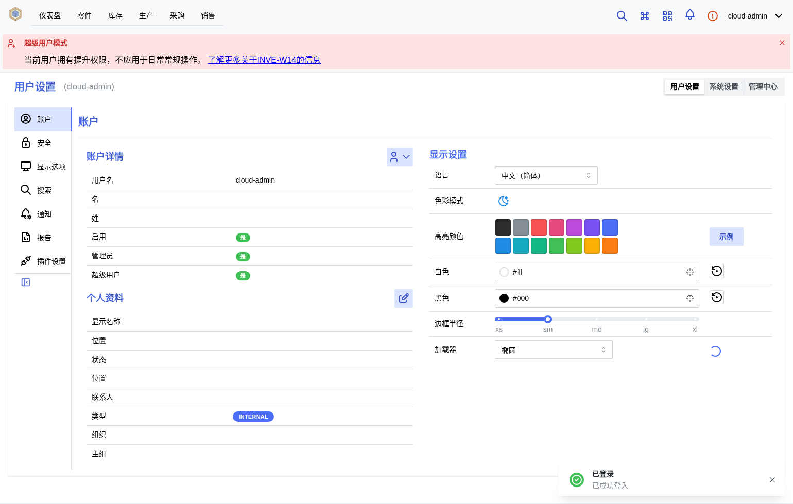

2. 在 **零件** 中创建「视触觉传感器 · 工位演示」分类和相关零件。在库存中创建「来料待检」「装配检测」「成品检通过」库位。演示为盖板、机加工件、摄像头、灯带、反光镜和解码板各建 1 件库存；另建一个「来料清点记录」库存项用于记录工位 1。

   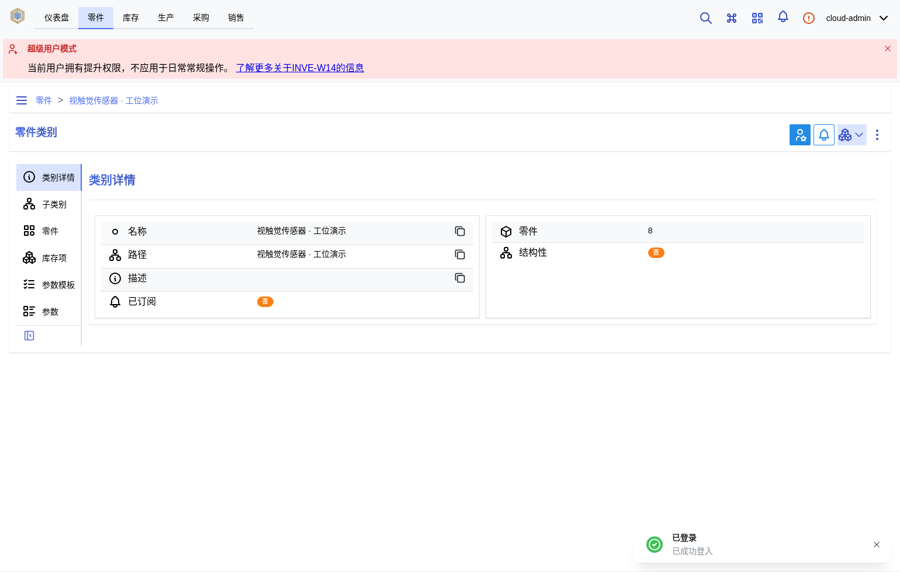

3. 将来料清点记录、工位 2–6 对应零件和传感器成品设为可测试。分别在零件的 **测试模板** 中添加下方对应的工位名称，启用「必检」和「要求填写值」。按本演示的附件要求，工位 2–6、8、10、11、12、14、16 同时启用「要求上传附件」。装配与成品阶段的模板都建在传感器成品上，供同一个生产产出的库存项使用。
4. 在传感器的 **BOM** 中录入上述六种实物部件，每种用量 1，保存后验证 BOM。演示把反光片检测登记在装配产出上；正式 BOM 请使用实际组件和用量。

## 每个工位的录入和上传方法

1. 打开对应的 **库存项 → 测试结果**，点 **＋**，选择该工位模板。
2. 填写 **结果、值、测试工位和备注**。数值检验写明单位和判定依据；多项检查可在值或备注逐项记录，必要时拆分为独立模板。
3. 有图像的工位在同一表单的 **附件** 字段选择 PNG，然后保存。本教程每站关联一张图，若需保留多张原图，可按检查项拆分模板，分别上传。
4. 保存后核对结果行，并点开该行的附件链接。工位 2 下方另附浏览器中实际打开已上传 PNG 的截图。

## 第 1 阶段 · 来料检

工位 1 在来料清点记录上登记，工位 2–6 在各自对应的零件库存项上登记。

### 工位 1 · 来料数量

- 检测内容：来料数量核对、数据录入。
- 所需设备：普通电脑。
- 演示录入：计划 6 类各 1 件；清点 6 件，差异 0（演示）。
- 本站登记数量核对结果，附件可留空。

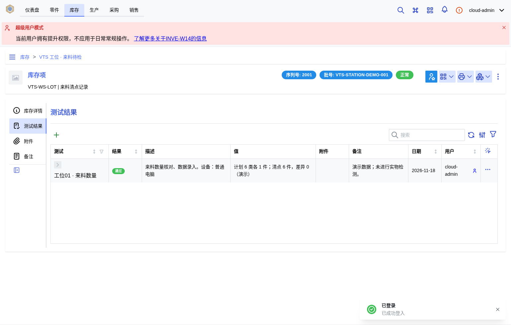

### 工位 2 · 盖板检测

- 检测内容：厚度检测、硬度检测、表面检测、数据录入。
- 所需设备：电脑+显卡、摄像头、厚度仪+硬度仪。
- 演示录入：已登记厚度、硬度与表面检查项（演示）。
- 附件：[盖板表面取证位置（演示 PNG）](evidence/WS02-demo.png)。

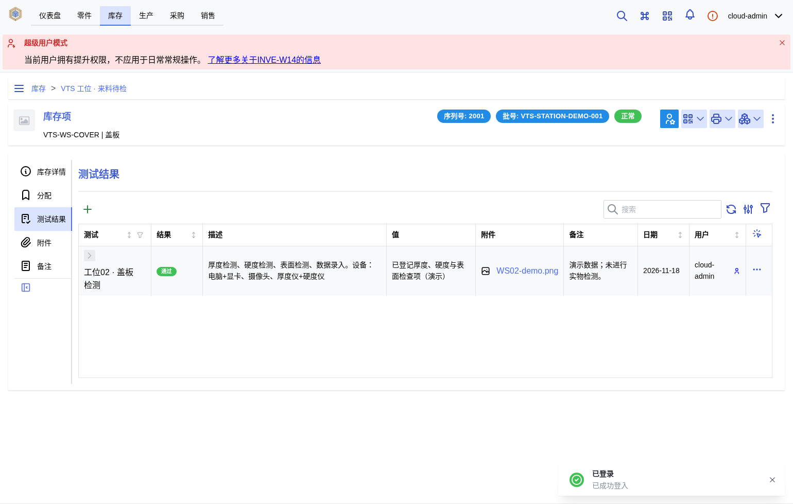

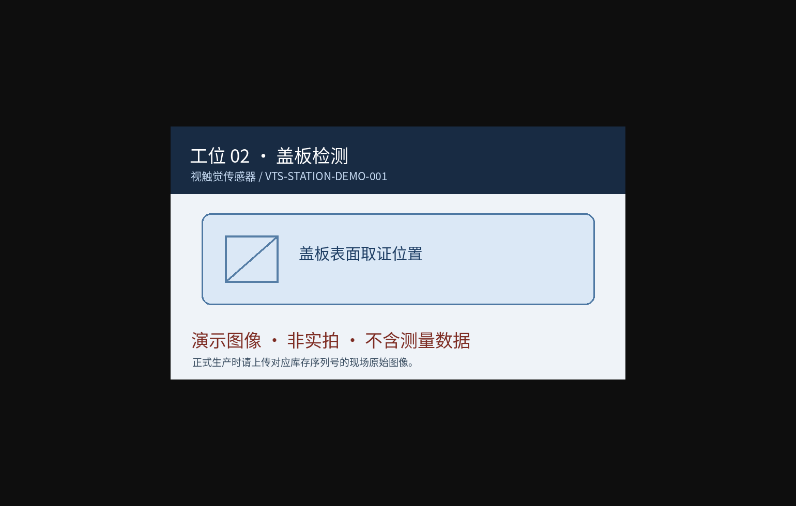

### 工位 3 · 机加工件检测

- 检测内容：夹爪打码、数据录入。
- 所需设备：普通电脑、镭射打码仪。
- 演示录入：夹爪打码示例 JAW-2001（演示）。
- 附件：[夹爪打码取证位置（演示 PNG）](evidence/WS03-demo.png)。

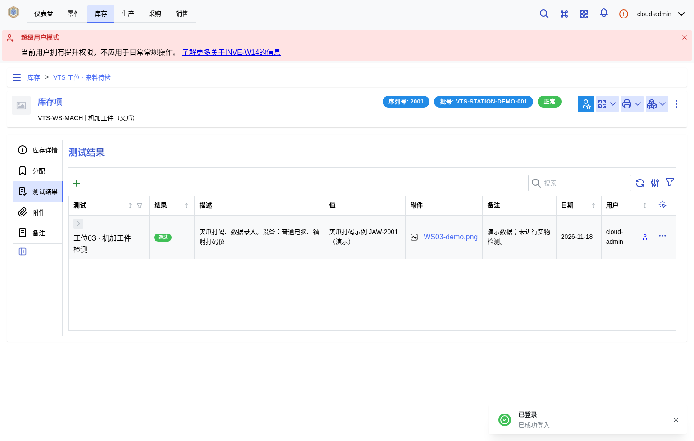

### 工位 4 · 摄像头检测

- 检测内容：摄像头视距检测、焦距标定、数据录入。
- 所需设备：普通电脑、标定板。
- 演示录入：已登记视距检查与焦距标定（演示）。
- 附件：[摄像头标定板示意（演示 PNG）](evidence/WS04-demo.png)。

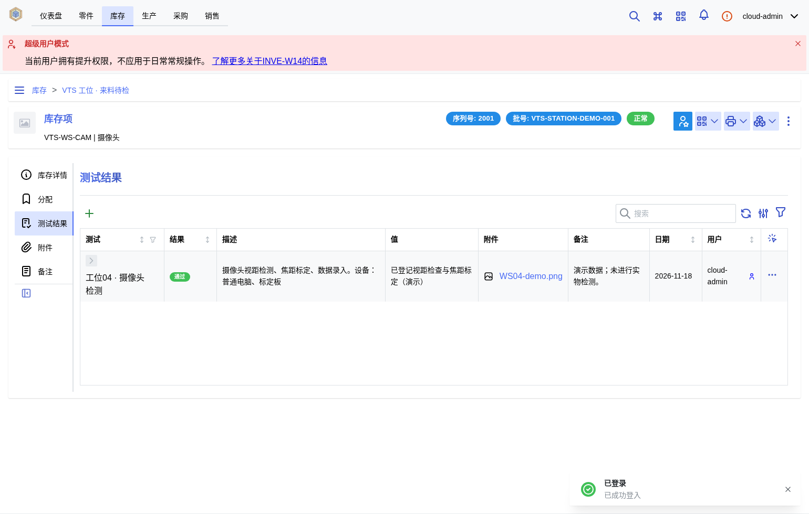

### 工位 5 · 灯带检测

- 检测内容：亮度检测、发热检测、数据录入。
- 所需设备：普通电脑、亮度仪、热成像仪。
- 演示录入：已登记亮度与发热检查（演示）。
- 附件：[灯带与热成像取证位置（演示 PNG）](evidence/WS05-demo.png)。

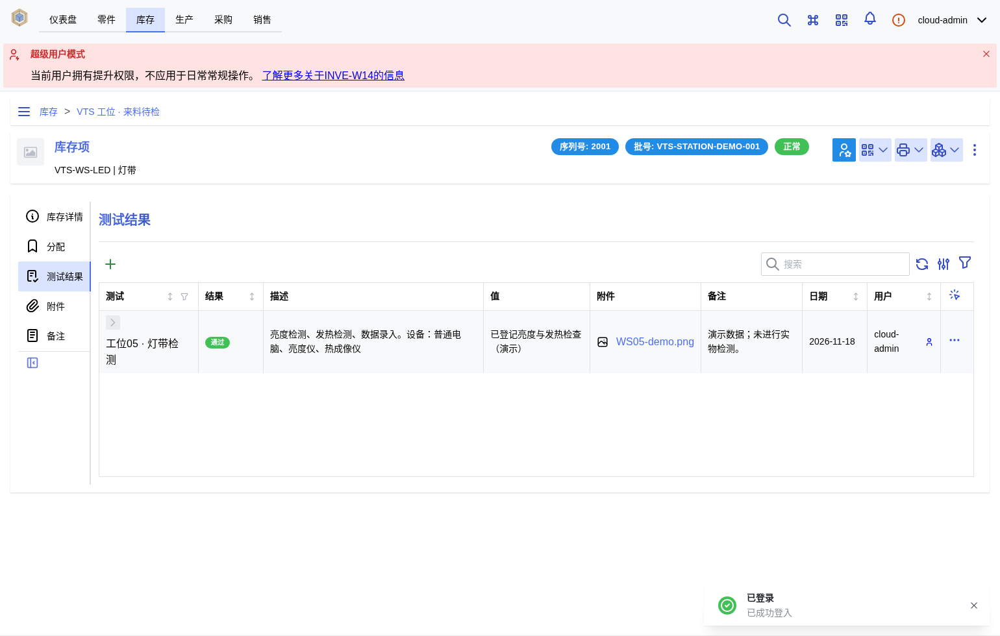

### 工位 6 · 反光镜检测

- 检测内容：反光镜检测、数据录入。
- 所需设备：普通电脑。
- 演示录入：已登记反光镜检查（演示）。
- 附件：[反光镜取证位置（演示 PNG）](evidence/WS06-demo.png)。

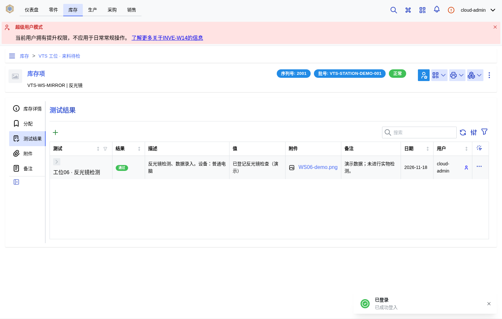

## 第 2 阶段 · 装配

确认工位 1–6 的结果已通过后，在 **生产** 新建并下达工单 `BO-9201`，选择传感器成品、数量 1，目的库位选「成品检通过」。新建序列号为 `2001` 的生产产出，暂放「装配检测」库位，将六种实物部件各 1 件分配给该产出。以下装配工位依次在该产出的库存项上登记。

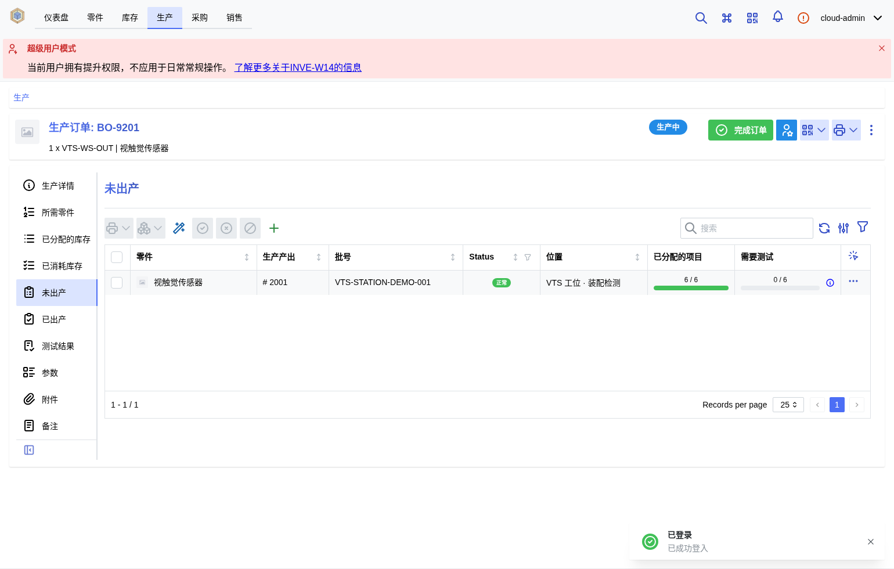

### 工位 8 · 反光片检测

- 检测内容：反光片检测、数据录入。
- 所需设备：普通电脑、半成品检测件。
- 演示录入：已登记装配后的反光片检查（演示）。
- 附件：[半成品反光片取证位置（演示 PNG）](evidence/WS08-demo.png)。

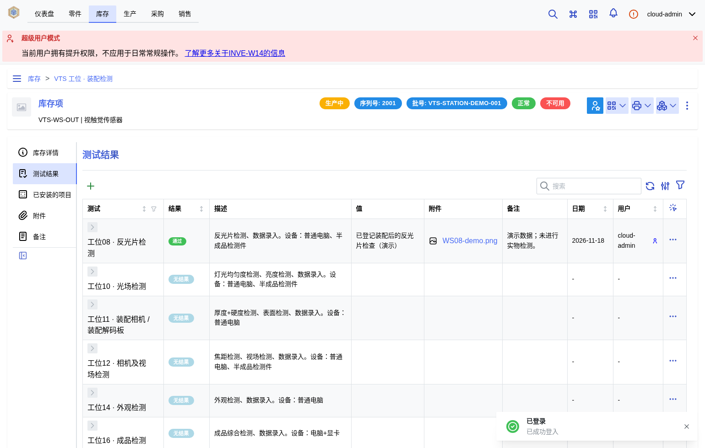

### 工位 10 · 光场检测

- 检测内容：灯光均匀度检测、亮度检测、数据录入。
- 所需设备：普通电脑、半成品检测件。
- 演示录入：已登记灯光均匀度与亮度检查（演示）。
- 附件：[光场采集范围示意（演示 PNG）](evidence/WS10-demo.png)。

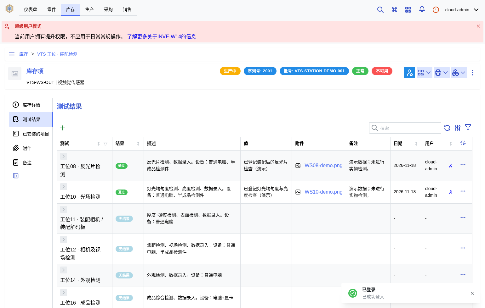

### 工位 11 · 装配相机 / 装配解码板

- 检测内容：厚度+硬度检测、表面检测、数据录入。
- 所需设备：普通电脑。
- 演示录入：已登记相机、解码板装配及厚度、硬度、表面检查（演示）。
- 附件：[相机与解码板装配位置示意（演示 PNG）](evidence/WS11-demo.png)。

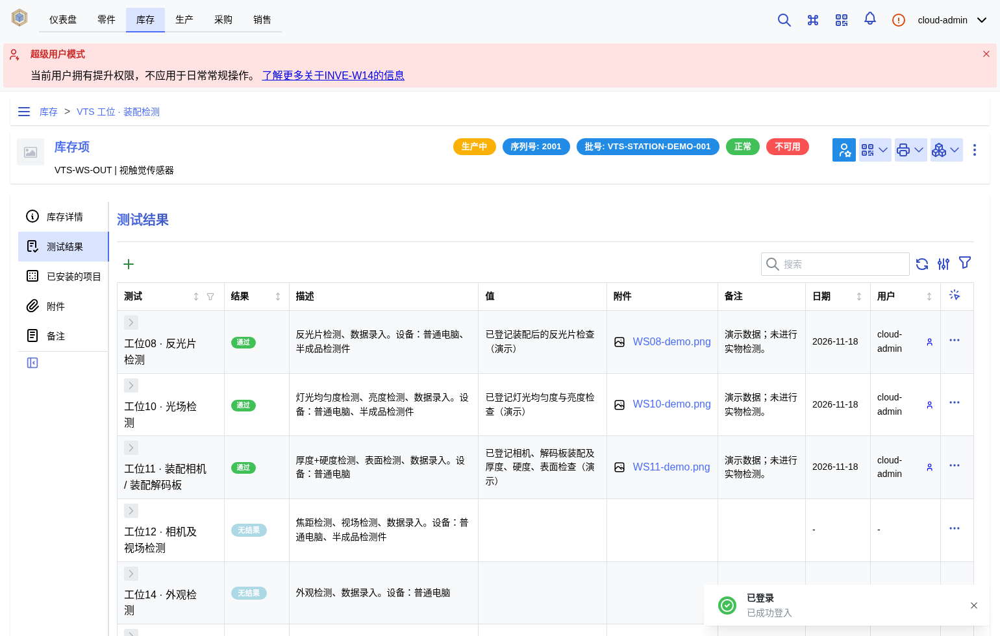

### 工位 12 · 相机及视场检测

- 检测内容：焦距检测、视场检测、数据录入。
- 所需设备：普通电脑、半成品检测件。
- 演示录入：已登记焦距及视场检查（演示）。
- 附件：[相机视场取证范围（演示 PNG）](evidence/WS12-demo.png)。

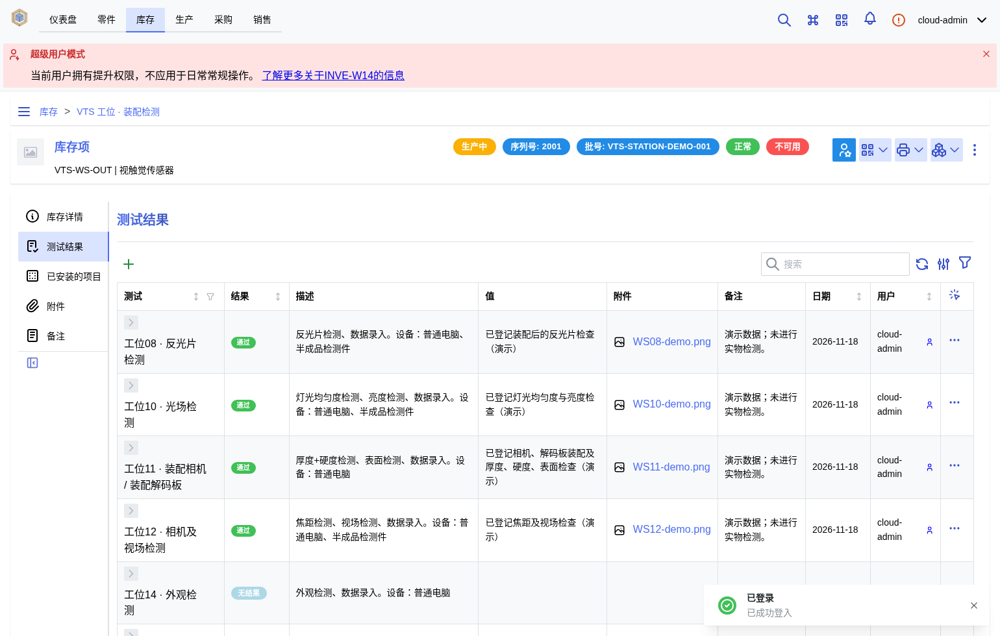

### 工位 14 · 外观检测

- 检测内容：外观检测、数据录入。
- 所需设备：普通电脑。
- 演示录入：已登记装配外观检查（演示）。
- 附件：[整机外观取证位置（演示 PNG）](evidence/WS14-demo.png)。

## 第 3 阶段 · 成品检

在装配阶段使用的同一序列号库存项上登记最终检测。

### 工位 16 · 成品检测

- 检测内容：成品综合检测、数据录入。
- 所需设备：电脑+显卡。
- 演示录入：已登记成品综合检查（演示）。
- 附件：[成品综合检测取证位置（演示 PNG）](evidence/WS16-demo.png)。

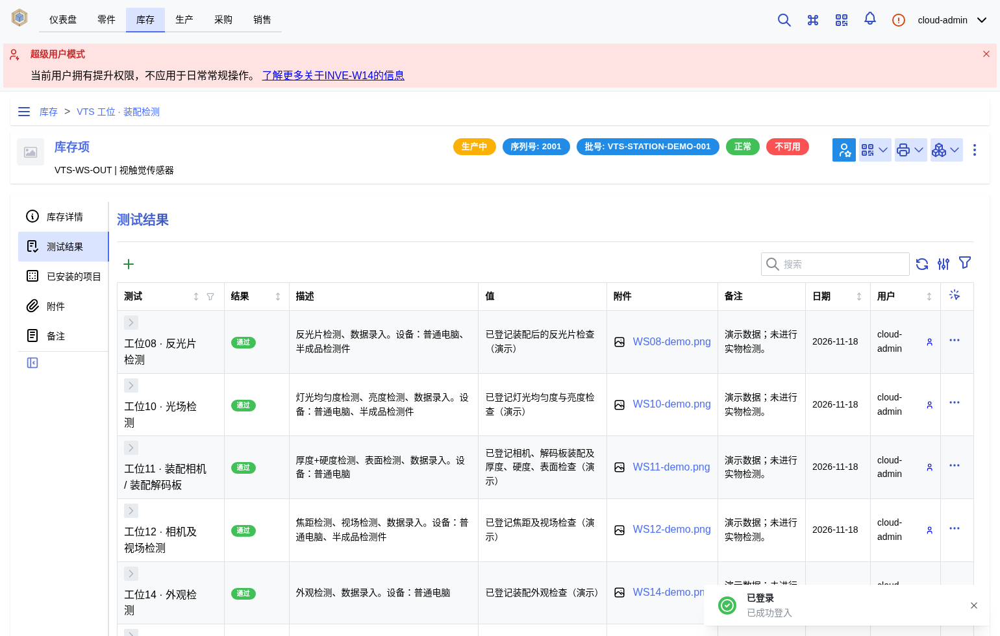

## 完成生产订单

核对工位 8、10、11、12、14、16 的通过结果和附件，再完成生产产出，将其入「VTS 工位 · 成品检通过」库位，并关闭生产订单。确认工单显示已完成产出 1 件，库存项保留六件已安装部件的追溯关系。

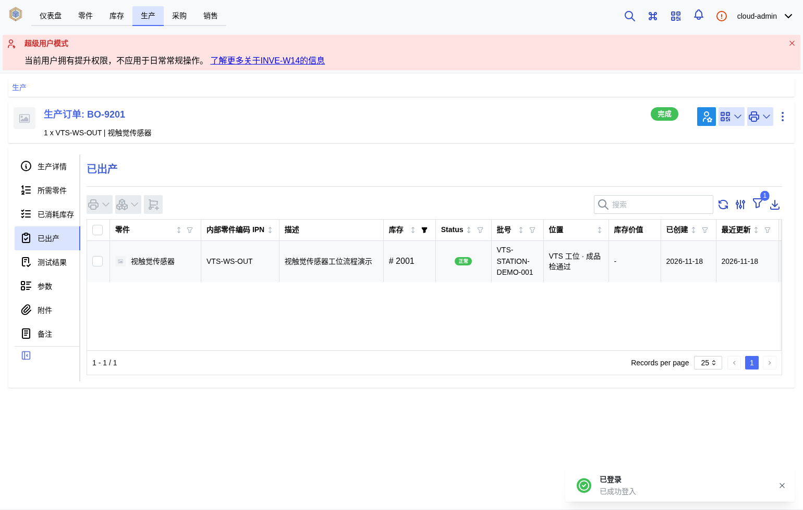
