# 用 InvenTree 记录视触觉传感器的生产流程

本教程使用 **1 件演示成品**，批号 `VTS-DEMO-001`，库存项序列号 `1001`。截图来自云环境中实际录入的 InvenTree 记录。检测结果均为假设数据，现场操作时请按检验规范填入实测值、判定及必要的附件。

## 录入前准备

1. 在 **账户设置 → 账户 → 显示设置** 中将语言设为 **中文（简体）**。自管实例也可在配置文件中设定 `language: zh-hans` 并重启服务；前端以账户选中的语言为优先。

   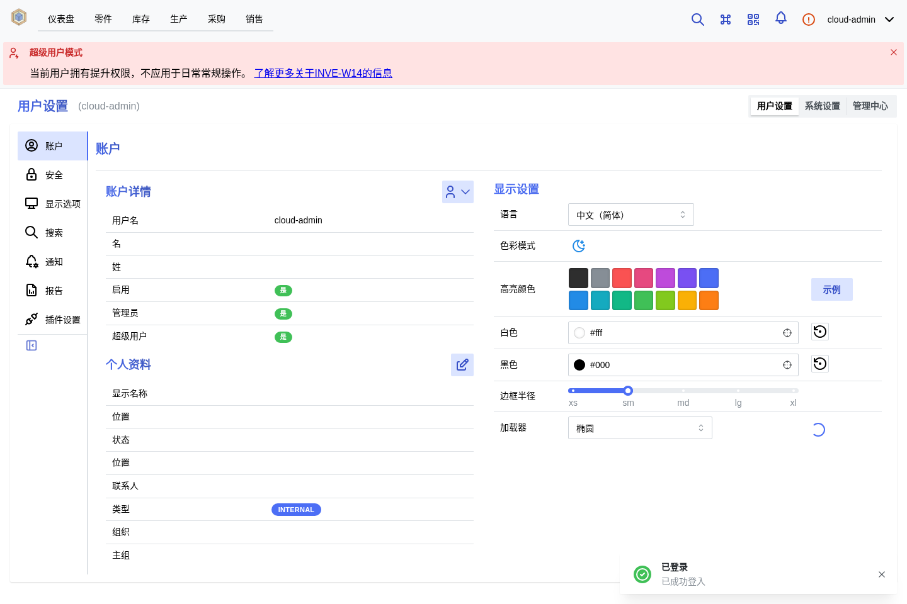

2. 进入 **零件**，新建分类「视触觉传感器演示」。在该分类创建 A、B、C、D、装配1半成品、装配2半成品和视触觉传感器成品。内部零件号依次为 `VTS-DEMO-A` 至 `VTS-DEMO-D`，以及 `VTS-DEMO-S1`、`VTS-DEMO-S2`、`VTS-DEMO-S3`。将各零件设为可跟踪，将 A–D 和成品设为可测试，将三道装配的产出设为装配件。
3. 在 **库存** 创建来料待检、装配周转、成品待检和已包装成品库位。在来料待检库位为 A–D 各建库存 1 件，每件使用批号 `VTS-DEMO-001` 和所属零件下的序列号 `1001`。

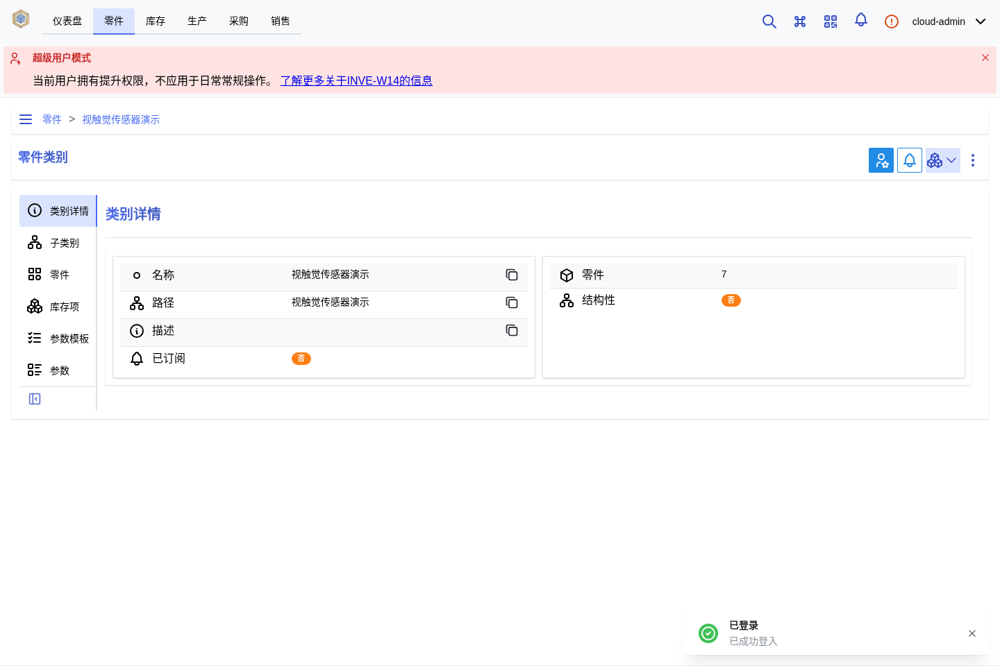

4. 打开各零件的 **测试模板**，新建 3 条必检项。A 使用 `A_test1`、`A_test2`、`A_test3`，B、C、D 以同样规则命名。成品新增一个名为「成品检测」的必检模板。

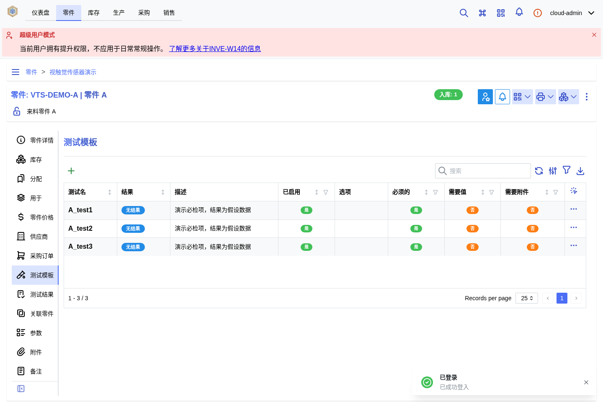

5. 在三种装配产出的 **BOM** 页面添加投入品，每个投入品的用量为 1，添加完后验证 BOM。

| 工单 | 投入品 | 产出 |
| --- | --- | --- |
| BO-9011 · 装配1 | A、B | 装配1半成品 |
| BO-9012 · 装配2 | 装配1半成品、C | 装配2半成品 |
| BO-9013 · 装配3 | 装配2半成品、D | 视触觉传感器成品 |

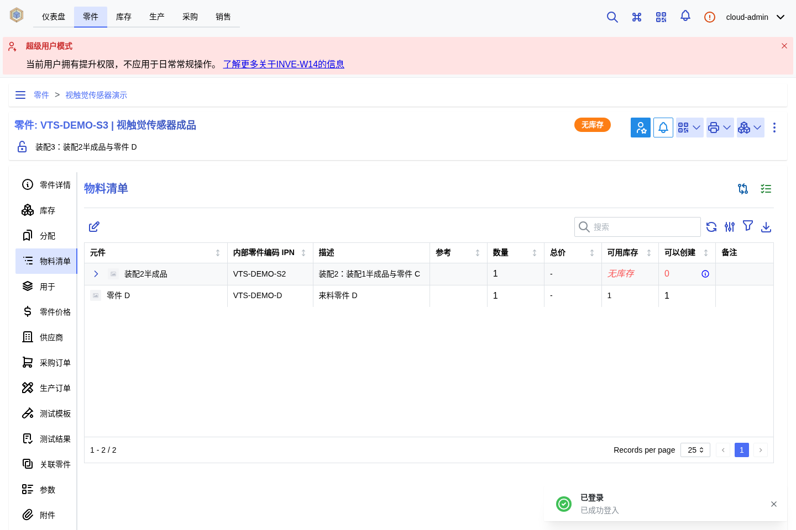

## 01–12 · 记录来料检测

打开对应的 **库存项 → 测试结果 → ＋**。选择下列模板，每次保存一条结果。演示的检测工位为「来料检测」，结果选「通过」。在领用库存之前，逐个确认该库存项的三条必检结果均已通过；实际不合格品按现场隔离流程处理。

### 01 · A_test1

在零件 A 的库存项上记录第 1 项检测结果。

### 02 · A_test2

在零件 A 的库存项上记录第 2 项检测结果。

### 03 · A_test3

在零件 A 的库存项上记录第 3 项检测结果。

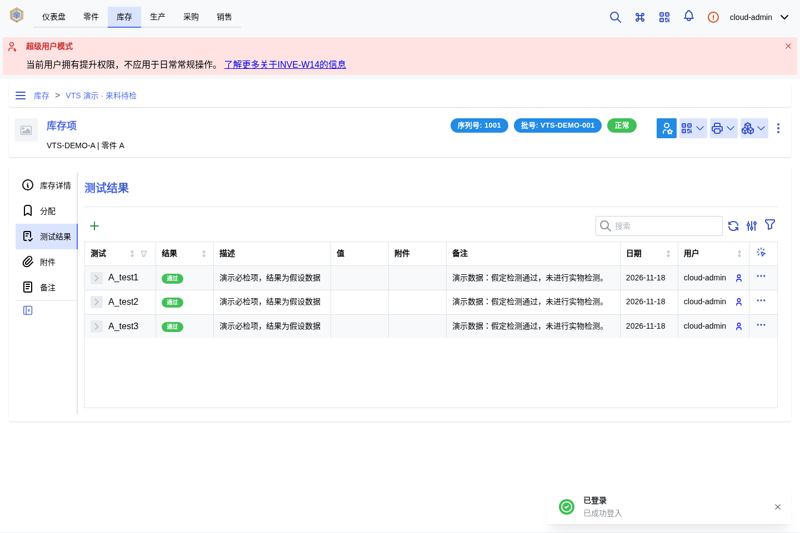

### 04 · B_test1

在零件 B 的库存项上记录第 1 项检测结果。

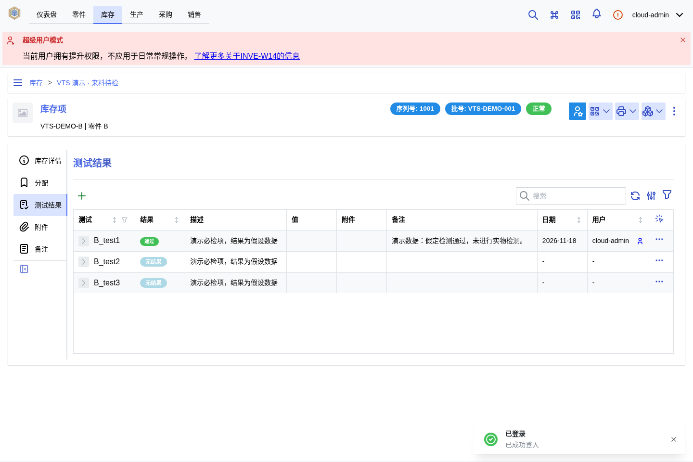

### 05 · B_test2

在零件 B 的库存项上记录第 2 项检测结果。

### 06 · B_test3

在零件 B 的库存项上记录第 3 项检测结果。

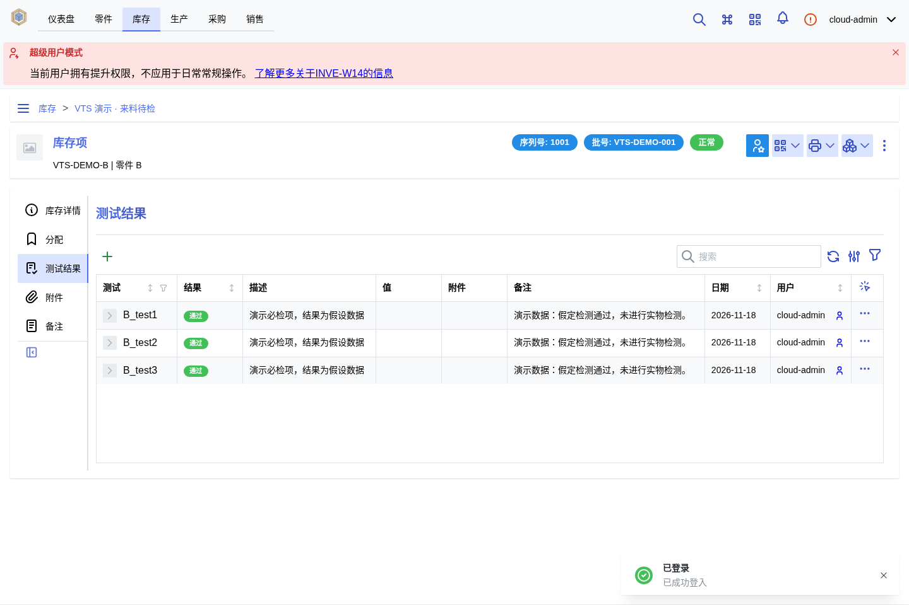

### 07 · C_test1

在零件 C 的库存项上记录第 1 项检测结果。

### 08 · C_test2

在零件 C 的库存项上记录第 2 项检测结果。

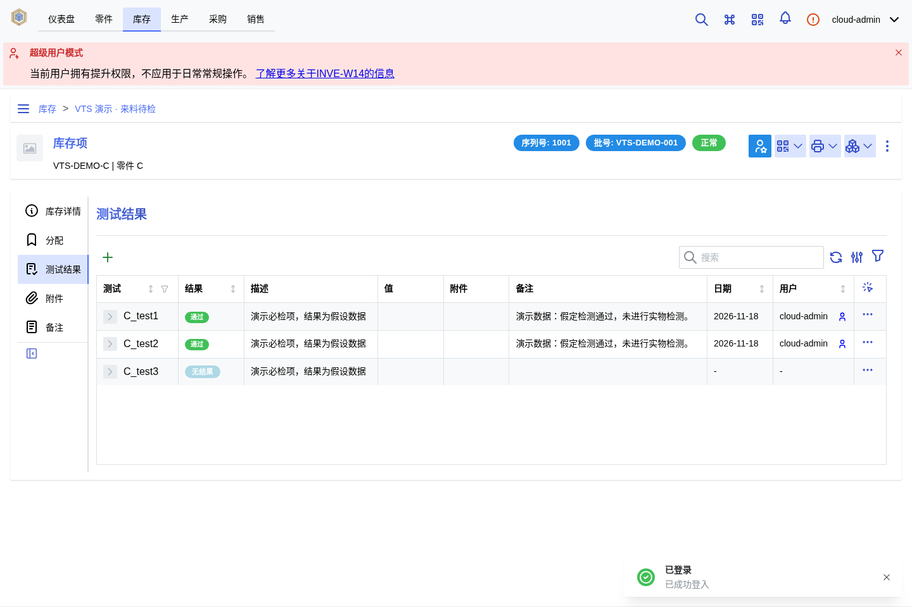

### 09 · C_test3

在零件 C 的库存项上记录第 3 项检测结果。

### 10 · D_test1

在零件 D 的库存项上记录第 1 项检测结果。

### 11 · D_test2

在零件 D 的库存项上记录第 2 项检测结果。

### 12 · D_test3

在零件 D 的库存项上记录第 3 项检测结果。

## 13–15 · 执行三道装配

从 **生产** 新建工单，选择对应产出零件，数量填 1，批号填 `VTS-DEMO-001`。下达工单后新增生产产出，填序列号 `1001`，再把对应的投入库存逐项分配到该产出。每道工序使用上一道已完成的半成品库存，便于在系统中追踪用料。

### 13 · 装配1

工单 `BO-9011` 分配 A 和 B 各 1 件。完成生产产出和工单，半成品入「VTS 演示 · 装配周转」。

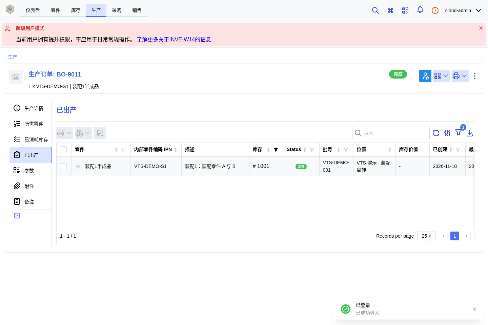

### 14 · 装配2

工单 `BO-9012` 分配装配1半成品和 C 各 1 件。完成生产产出和工单，半成品入「VTS 演示 · 装配周转」。

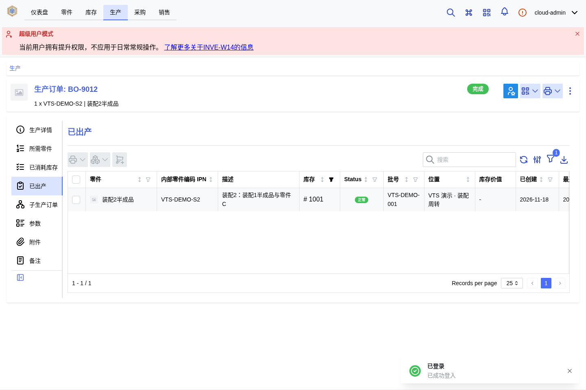

### 15 · 装配3

工单 `BO-9013` 分配装配2半成品和 D 各 1 件，登记成品产出，目的库位为「VTS 演示 · 成品待检」。保留待检的生产产出，等第 16 步通过后再完工。

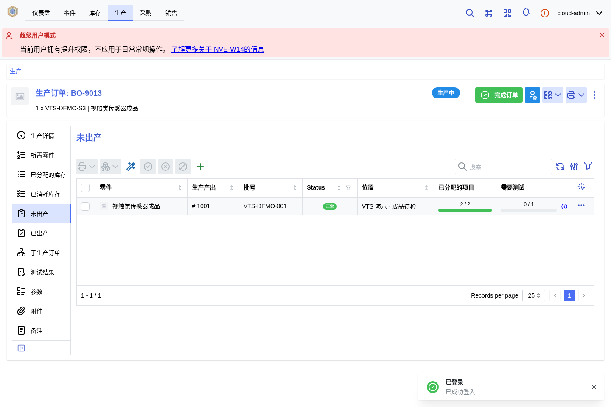

## 16 · 成品检测

从工单 `BO-9013` 打开待检产出的库存项。在 **测试结果** 新增「成品检测」并记录实测判定，工位填写「成品检验」。确认通过后，回到工单完成产出并关闭工单。

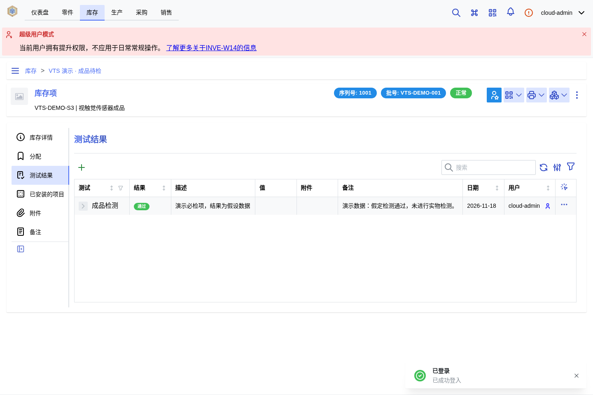

## 17 · 成品包装

确认成品检测通过后，包装该件成品。在成品库存项执行库存转移，目的库位选择「VTS 演示 · 已包装成品」，包装字段填「防静电袋 + 纸盒（演示）」，并保存备注。转移后核对序列号、批号、库位和包装字段。

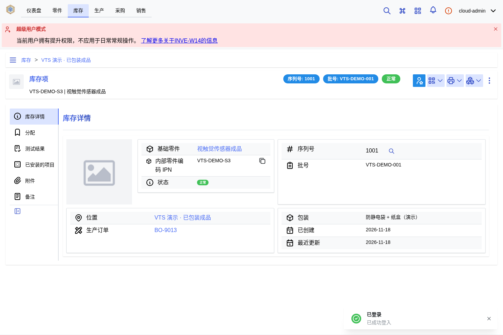

包装以库存转移记录留痕；需要独立包装工单、包装材料扣减或出货放行时，应按现场流程另建对应记录。
